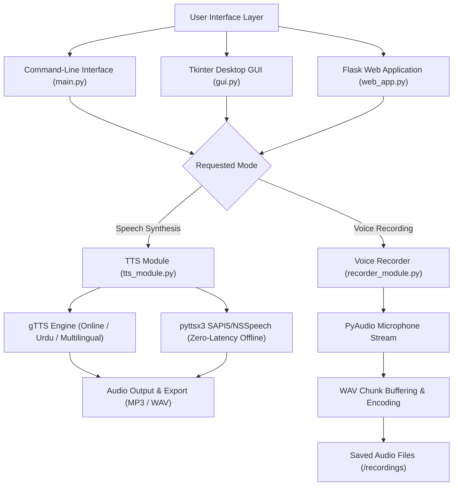

# Multilingual Text-to-Speech & Voice Recorder Suite


A multi-interface audio engineering toolkit providing online and offline text-to-speech synthesis (with specialized Urdu language support) paired with PyAudio microphone recording across CLI, Tkinter GUI, and Flask web interfaces.

---

## 🏛️ System Architecture



---

## 🔬 Core Capabilities

- **Tri-Interface Design:** Access identical synthesis and recording functionality through interactive CLI, responsive Tkinter desktop GUI, or a lightweight Flask web application.
- **Dual-Engine Speech Synthesis:**
  - **Online Synthesis (`gTTS`):** Natural speech generation supporting Urdu (`ur`) and English.
  - **Offline Synthesis (`pyttsx3`):** Zero-latency local system speech synthesis without network dependency.
- **PyAudio Microphone Stream:** Chunked audio recording with custom sample rate and channel configuration, exporting directly to standardized WAV format.

---

## 📁 Repository Structure

```
tts-voice-recorder-python/
├── main.py                # Command-line interface entrypoint
├── gui.py                 # Tkinter desktop interface
├── web_app.py             # Flask web application
├── tts_module.py          # Unified gTTS & pyttsx3 speech synthesizer
├── recorder_module.py     # PyAudio recording and file writer
└── requirements.txt       # Dependencies manifest
```

---

## 🚀 Quickstart CLI Commands

### 1. Installation
```bash
git clone https://github.com/sultanriaz/tts-voice-recorder-python.git
cd tts-voice-recorder-python
python -m venv venv
# Linux / macOS:
source venv/bin/activate
# Windows:
.\venv\Scripts\Activate.ps1

pip install -r requirements.txt
```

### 2. Run Modes
- **Launch Desktop GUI:**
  ```bash
  python gui.py
  ```
- **Launch Web Interface:**
  ```bash
  python web_app.py
  ```
- **Run Command-Line Interface:**
  ```bash
  python main.py
  ```
